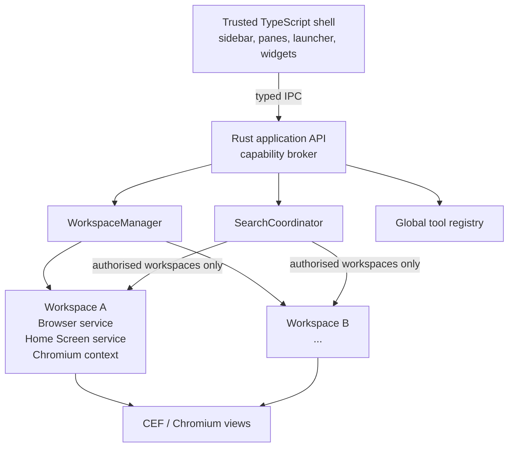

:::note[Planned design]
This is the intended architecture from the design spec. Items marked *to validate* depend on the M0 feasibility spike.
:::

A trusted TypeScript shell draws the interface. Everything that touches data goes through a narrow typed interface into
Rust, which decides what each caller may see. Chromium draws web pages.



## Services

These are logical Rust structs inside one process, not operating-system services. Traits are added only at real boundaries.

| Service | Owns |
|---|---|
| WorkspaceManager | Workspace lifecycle: create, rename, delete, restore, look up. |
| WorkspaceBrowserService | Tabs, groups, history, bookmarks, downloads, the search index. |
| WorkspaceHomeScreenService | Launcher entries, tool instances, widgets, layouts. |
| ChromiumSession | The CEF request context for one workspace. |
| PaneManager | Layout and the focused pane. Panes hold no credentials. |
| SearchCoordinator | Works out the allowed scope, queries authorised services, merges and labels results. |
| Capability broker | Describes tools, validates calls, supplies only permitted data. |
| WindowManager | One window in v1, without preventing more later. |

## Storage

```text
application-data/
├── browser.db                 global metadata and preferences only
├── chromium-root/<id>/        Chromium-managed cookies, storage, cache
└── workspaces/<id>/
    ├── browser.db             history, bookmarks, tabs, groups, search
    └── homescreen.db          launcher, widgets, tool instances
```

Workspaces are keyed by generated IDs, never by their names. There are no cross-database transactions, so operations are
designed to be repeatable or recoverable.

## Technology

| Area | Direction | Status |
|---|---|---|
| Core | Rust | Agreed |
| Rendering | Chromium via CEF | Agreed direction; bindings to validate |
| Shell | Direct CEF, or Tauri with CEF | To validate |
| Data | SQLite per workspace by responsibility | Agreed |
| UI | Reuse Home Screen TypeScript concepts | Agreed intention |
| Tool isolation | Restricted model designed up front | Required; format deferred |

See [privacy and security](/dev_browser/reference/privacy-and-security/) for the trust boundaries.
