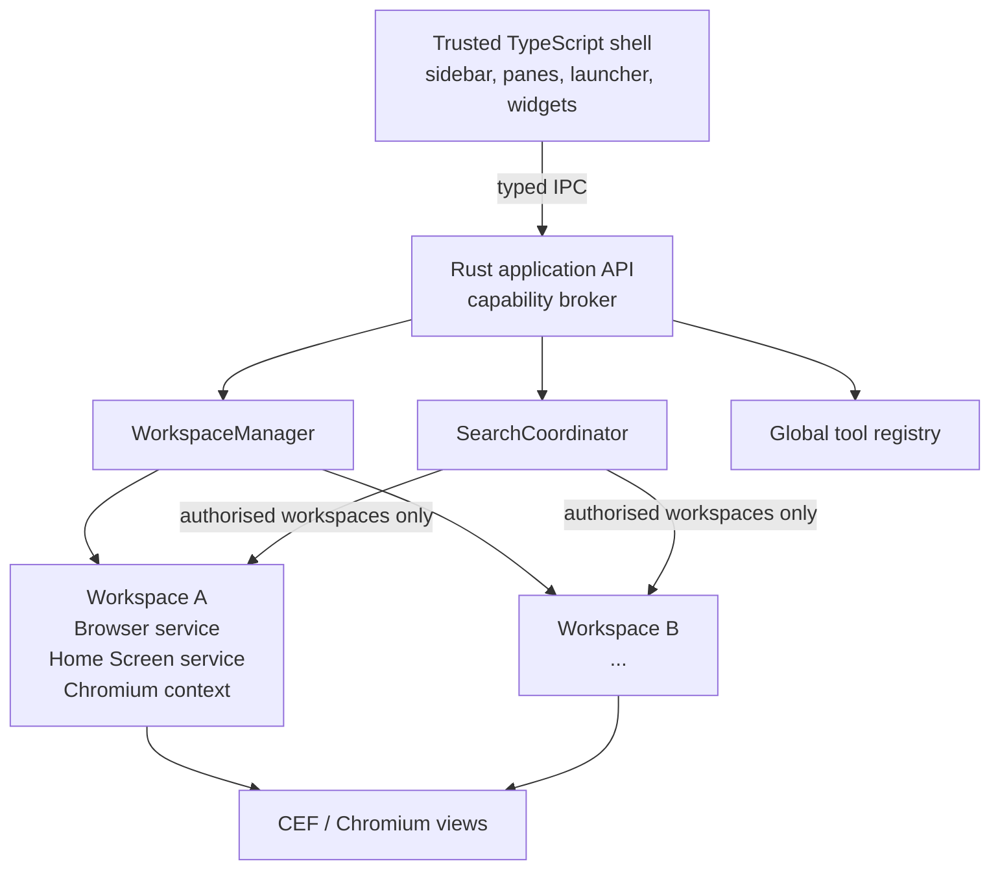

:::note[Partly built]
The parts marked built in the table at the end exist in the alpha. The rest is the intended design from the specification.
:::

A trusted TypeScript shell draws the interface. Everything that touches data goes through a narrow typed interface into
Rust, which decides what each caller may see. Chromium draws web pages.



## Services

These are logical Rust structs inside one process, not operating-system services. Traits are added only at real boundaries.

| Service | Owns |
|---|---|
| WorkspaceManager | Workspace lifecycle: create, rename, delete, restore, look up. |
| WorkspaceBrowserService | Tabs, groups, history, bookmarks, downloads, the search index. |
| WorkspaceHomeScreenService | Launcher entries, tool instances, widgets, layouts. |
| ChromiumSession | The CEF request context for one workspace. |
| PaneManager | Layout and the focused pane. Panes hold no credentials. |
| SearchCoordinator | Works out the allowed scope, queries authorised services, merges and labels results. |
| Capability broker | Describes tools, validates calls, supplies only permitted data. |
| WindowManager | One window in v1, without preventing more later. |

## Storage

```text
application-data/
├── browser.db                 global metadata and preferences only
├── chromium-root/<id>/        Chromium-managed cookies, storage, cache
└── workspaces/<id>/
    ├── browser.db             history, bookmarks, tabs, groups, search
    └── homescreen.db          launcher, widgets, tool instances
```

Workspaces are keyed by generated IDs, never by their names. There are no cross-database transactions, so operations are
designed to be repeatable or recoverable.

## How it is built today

The Rust code is split in two. `core` knows nothing about Chromium: it holds the data, decides what the shell may do, and answers every request with replies and **effects** (show this tab, destroy that view, delete this workspace's data). `host` is the only part that touches CEF; it carries out effects and feeds events (a title changed, a download started) back to core. One thread owns all of it.

The shell is a small Preact page served from `app://shell`. It talks to the app over a narrow message channel that exists only for that page; the app re-checks who sent every message. The shell never names a file, a tab of another workspace, or a path: core rejects what it did not offer. Tabs are records in the workspace's own database, and a tab's page (its view) is disposable: core keeps at most eight alive and recreates the rest from the record.

## Technology

| Area | Direction | Status |
|---|---|---|
| Core | Rust | Agreed |
| Rendering | Chromium via CEF | Agreed; validated in the M0 spike (Windows) |
| Shell | Direct CEF through the cef-rs bindings, Alloy-style views | Decided after the M0 spike (Windows) |
| Data | SQLite per workspace by responsibility | Agreed |
| UI | Reuse Home Screen TypeScript concepts | Agreed intention |
| Tool isolation | Restricted model designed up front | Required; format deferred |
| Built so far | Workspaces, per-workspace storage, sidebar, tabs, navigation, error pages, downloads, restore | M1, unreleased alpha |

See [privacy and security](/dev_browser/reference/privacy-and-security/) for the trust boundaries.
